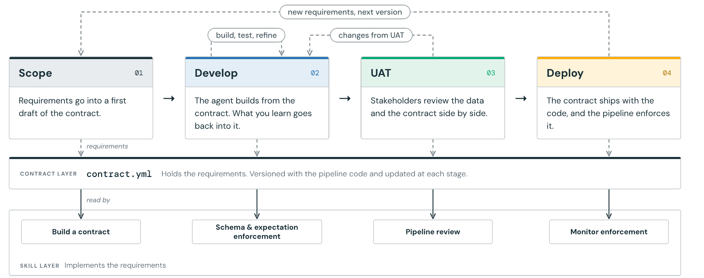
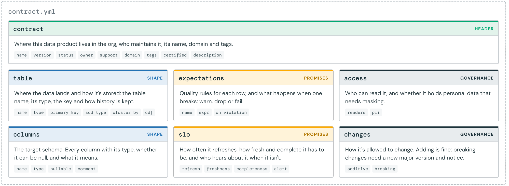
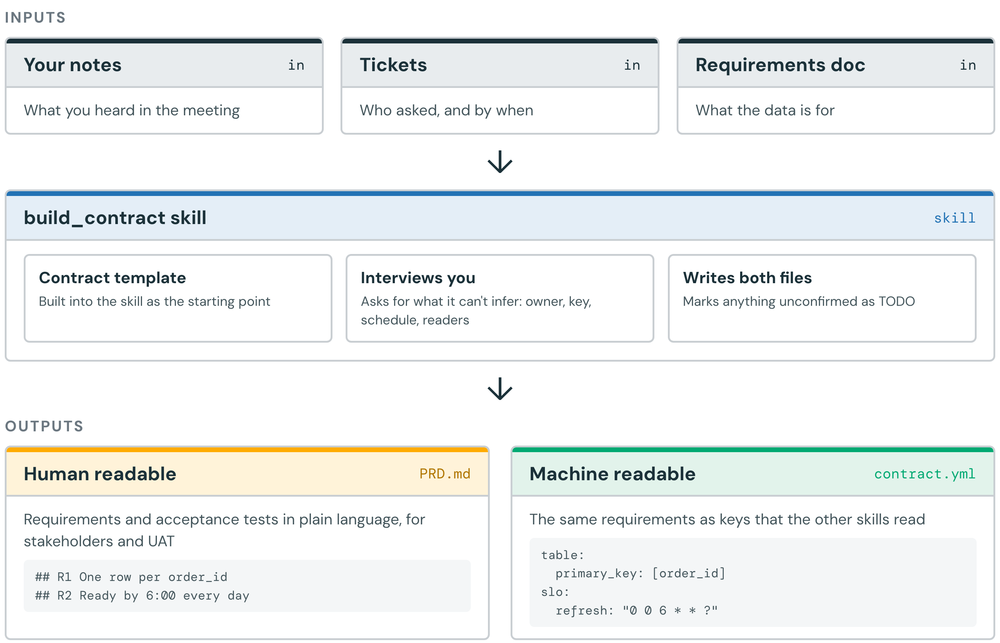
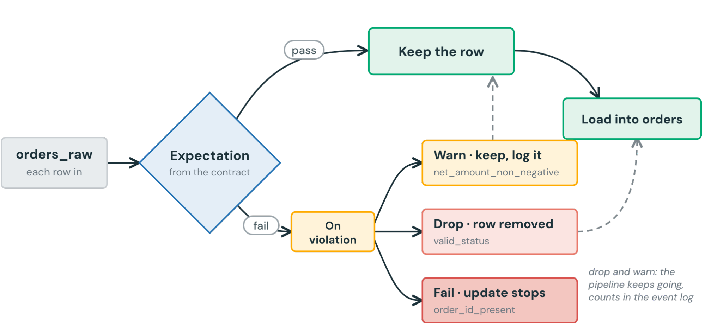
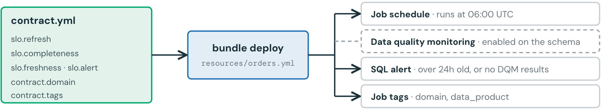
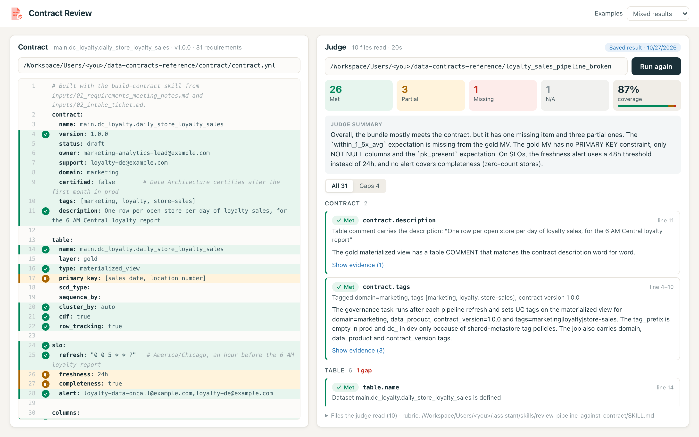
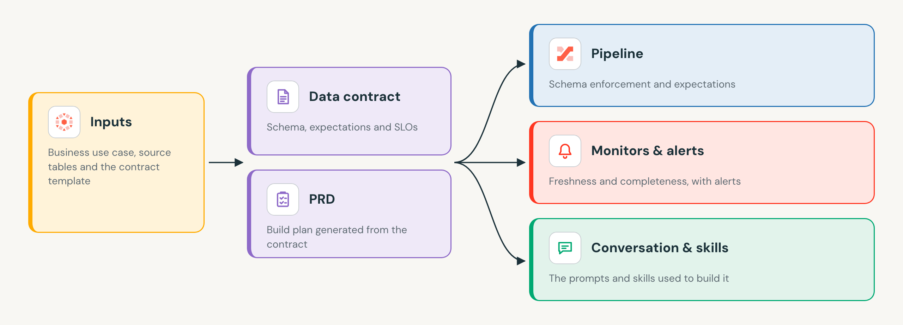

<p align="center"></p>

# Data Contracts for Agentic Development

A data contract is a small YAML file that writes down what a data product promises. In this repo, agent skills read
that contract and build a Databricks pipeline that keeps every promise. The pipeline uses Spark Declarative Pipelines
(SDP) and ships as a Declarative Automation Bundle (DAB). Then the platform enforces the contract on every run, and
an LLM judge checks that the code matches the contract.

**Write it down, build from it, enforce it.**

1. **Write the promise down.** A contract is a file in your repo: the blueprint for the table and what stakeholders
   can expect from it.
2. **Build from the contract.** Skills read the contract and map each requirement to code. The agent builds to a fixed
   list of requirements, so both the agent and your data are held to the promise.
3. **Let the platform enforce it.** Schemas, expectations, monitors and alerts turn each promise into a check.

---

## Why a contract?

Most teams building with a coding agent start each project from chat history and memory. The requirements live in a
conversation, so they're gone by the next session, and nothing checks the finished pipeline against what was asked.

A contract gives the agent requirements that last. It's versioned with the pipeline code and updated at each stage.
Skills read it at each stage of the lifecycle:

<p align="center"></p>

## 1. The contract

[`contract_template.yml`](skills/build-contract/templates/contract_template.yml) has seven sections. People can read it
and agents can parse it, and it's easy to check that nothing was left out.

<p align="center"></p>

| Section | What it promises |
|---|---|
| `contract` | Who owns it, its name, version, status, domain and tags |
| `table` | Where the data lands and how it's stored: type, primary key, SCD type, clustering, CDF, row tracking |
| `columns` | The schema: every column with its type, whether it can be null, and a comment |
| `expectations` | Row-level quality rules and what happens when one breaks: `warn`, `drop` or `fail` |
| `slo` | Refresh schedule, freshness, completeness, and who gets alerted |
| `access` | Who can read it and whether it holds PII |
| `changes` | Additive changes are allowed; breaking changes need a new major version and notice |

A completed example for the demo use case is in
[`reference_build/contract/contract.yml`](reference_build/contract/contract.yml), with its
[`PRD.md`](reference_build/contract/PRD.md).

## 2. Skills turn the contract into code

A skill is a folder with a `SKILL.md` file. The file tells the agent when to use the skill, the steps and rules to
follow, and where the reference examples are. The agent sees only each skill's name and description until a task
matches one. The four skills here (for Genie Code, or any agent that reads `SKILL.md`) cover the lifecycle:

| Skill | Reads | Writes |
|---|---|---|
| [`build-contract`](skills/build-contract/SKILL.md) | Meeting notes, tickets, requirements docs + the template | `contract.yml`, marking anything unconfirmed as `TODO(question)` |
| [`build-prd`](skills/build-prd/SKILL.md) | The contract + the notes | `PRD.md`: requirements traced to contract keys, each with an acceptance test |
| [`build-pipeline-from-contract`](skills/build-pipeline-from-contract/SKILL.md) | The contract + the PRD | A DAB with an SDP pipeline, job, alerts, tags, grants and data quality monitoring |
| [`review-pipeline-against-contract`](skills/review-pipeline-against-contract/SKILL.md) | The contract + the bundle | A verdict for each requirement (met / partial / missing), citing file and line |

One interview produces two files: a PRD for people and a contract for the pipeline.

<p align="center"></p>

## 3. Spark Declarative Pipelines enforce the shape and the rules

SDP suits contracts because the pipeline owns its tables: only one pipeline can write to a table. So the whole
pipeline is built and checked against one contract, instead of piece by piece. SDP also has a built-in feature for
most contract keys, so each key maps to one standard way to enforce it:

| Contract key | SDP / Delta |
|---|---|
| `columns`, `table.primary_key` | Explicit schema with `NOT NULL`, comments and a primary key; the update fails fast if the shape drifts |
| `expectations` | `CONSTRAINT ... EXPECT (...)` with `warn`, `ON VIOLATION DROP ROW` or `ON VIOLATION FAIL UPDATE` |
| `table.scd_type`, dedupe rules | `AUTO CDC ... KEYS (...) SEQUENCE BY ... STORED AS SCD TYPE 1/2` |
| `table.cluster_by`, `cdf`, `row_tracking` | `CLUSTER BY AUTO`, `delta.enableChangeDataFeed`, `delta.enableRowTracking` |
| `slo.completeness` | The gold table has a row for every expected entity, so a missing one shows up as a zero row |

<p align="center"></p>

## 4. DABs ship the schedule, monitors and alerts with the code

The bundle deploys the parts of the contract that aren't pipeline SQL: the job schedule from `slo.refresh`,
freshness and completeness SQL alerts, failure emails to `slo.alert`, UC tags from `contract.domain` and
`contract.tags`, `GRANT SELECT` for `access.readers`, and data quality monitoring (anomaly detection plus data
profiling). One `bundle deploy` takes it all through dev to prod.

<p align="center"></p>

## 5. Review: an LLM judge checks the bundle against the contract

[`contract_review_app/`](contract_review_app/) is a Databricks App (AppKit) that runs the
`review-pipeline-against-contract` skill as its rubric. The contract is on the left; on the right, each requirement
gets a verdict (met, partial or missing) with file-and-line evidence, and the app checks every citation against the
file. The list of requirements comes straight from the contract in code, so the LLM can't skip one.

<p align="center"></p>

The screenshot shows the **Mixed results** example: the broken bundle, judged with 26 met, 3 partial and 1 missing.

---

## The demo

The example data product is **daily store loyalty sales for marketing, ready by 6 AM**. Every open store should have
at least one sale; a store above 1.5x its 28-day average gets flagged. Duplicates are kept in bronze for audit and
removed in silver.

<p align="center"></p>

It takes about 10 minutes: the inputs → Genie Code builds the contract, PRD and bundle with the skills → the deployed
pipeline enforces it → the Contract Review app judges a correct bundle and one with four planted gaps. The run of show,
prompts and gotchas are in **[docs/demo-guide.md](docs/demo-guide.md)**.

## What's in the repo

| Path | What it is |
|---|---|
| [`skills/`](skills/) | The four skills. The contract template is in [`build-contract/templates/`](skills/build-contract/templates/contract_template.yml); syntax examples for every contract key are in [`build-pipeline-from-contract/examples/`](skills/build-pipeline-from-contract/examples/) |
| [`workspace_inputs/`](workspace_inputs/) | What the demo starts from: requirements interview notes and an intake ticket |
| [`source_data/`](source_data/) | **DAB:** a source schema plus a job that generates 60 days of synthetic POS loyalty data, with planted problems (duplicates, voids, missing members, negative amounts, silent stores, an outlier) |
| [`reference_build/contract/`](reference_build/contract/) | The **completed contract** and its PRD |
| [`reference_build/loyalty_sales_pipeline/`](reference_build/loyalty_sales_pipeline/) | **Pipeline DAB** built from the contract: bronze → silver (AUTO CDC dedupe) → gold, job, alerts, governance, DQM |
| [`reference_build/loyalty_sales_pipeline_broken/`](reference_build/loyalty_sales_pipeline_broken/) | The same bundle with four planted gaps, for the judge (never deploy it) |
| [`contract_review_app/`](contract_review_app/) | **App DAB:** Contract Review, the LLM judge |
| [`generality_test/`](generality_test/) | An unrelated `orders` contract, to show the judge works on any contract in the template's shape |
| [`setup.sh`](setup.sh) | Uploads skills and inputs, deploys the bundles, grants the app read access |

## Quick start

You need the [Databricks CLI](https://docs.databricks.com/dev-tools/cli/) with a configured profile, `jq`, a Unity
Catalog catalog you can create schemas in, a SQL warehouse, and a Foundation Model API chat endpoint for the judge
(default `databricks-claude-sonnet-5-5`).

```bash
export PROFILE=my-profile CATALOG=my_catalog WAREHOUSE_ID=<sql-warehouse-id>
./setup.sh all      # skills, inputs, source data, reference build, pipeline run, app
```

`./setup.sh` with no arguments lists each step so you can run them one at a time. See
[docs/demo-guide.md](docs/demo-guide.md) for the full walkthrough.
